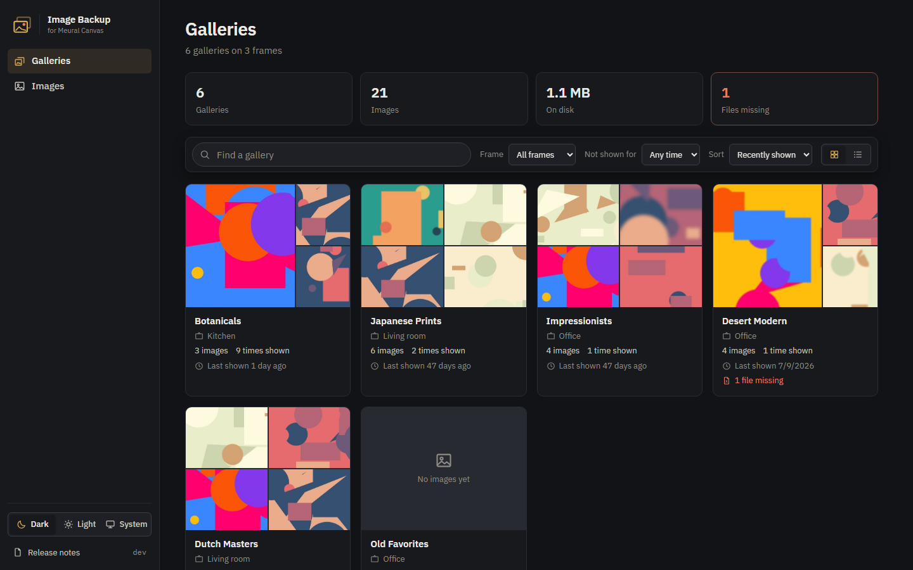
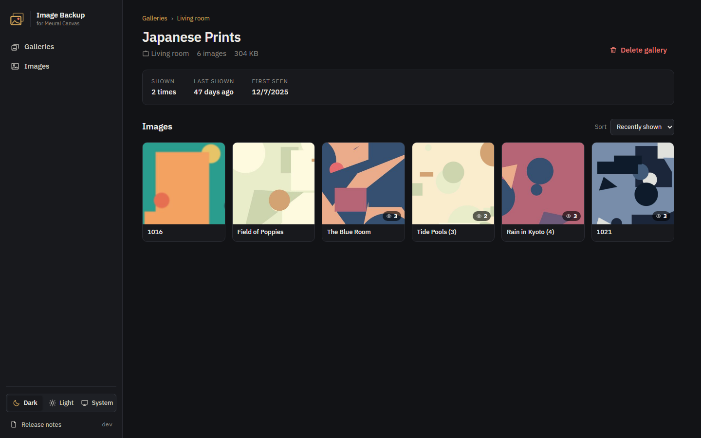
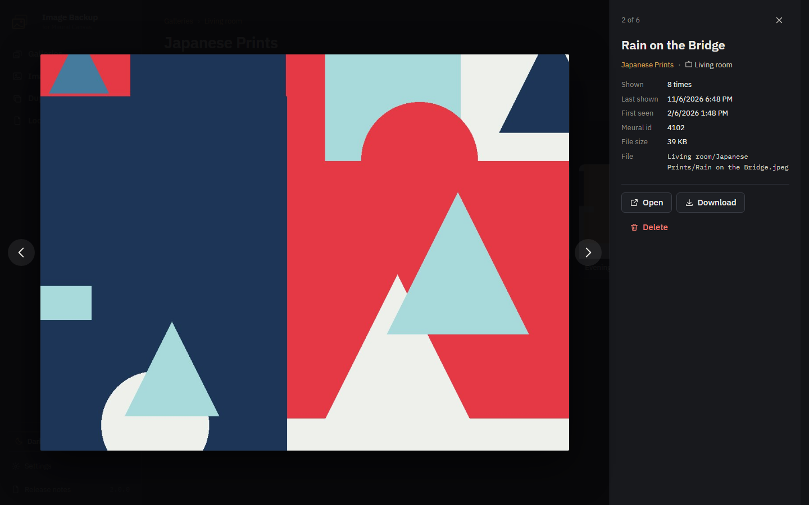
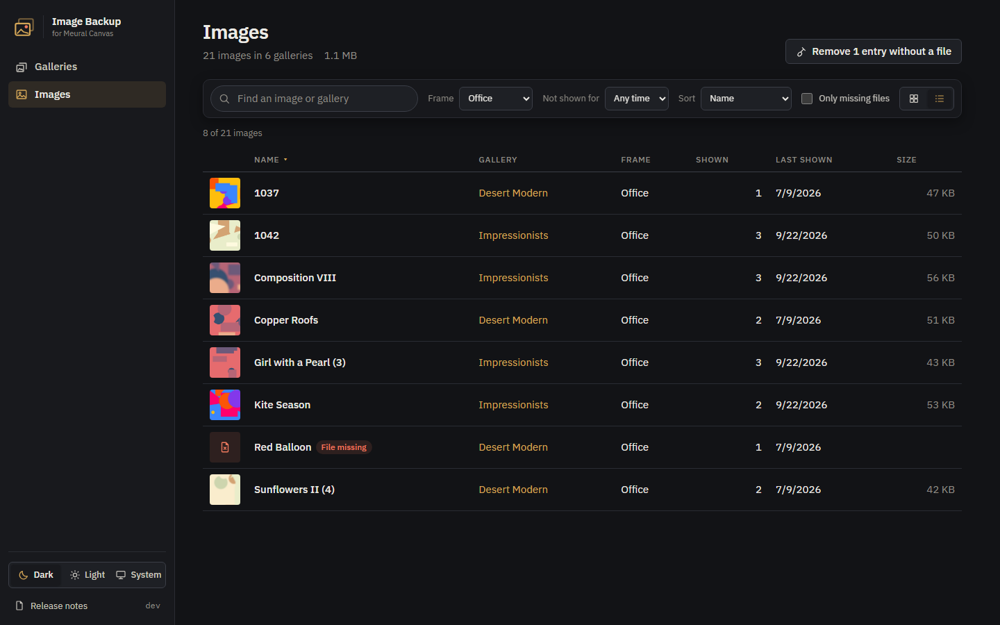
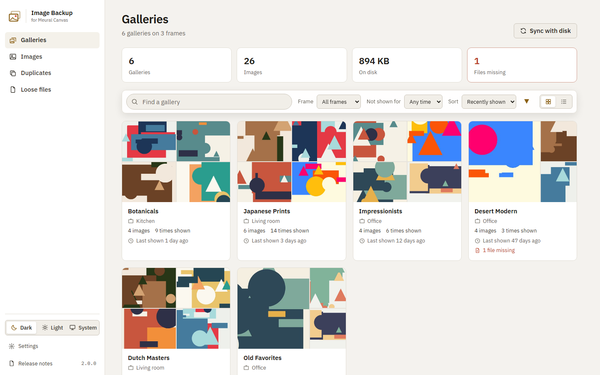
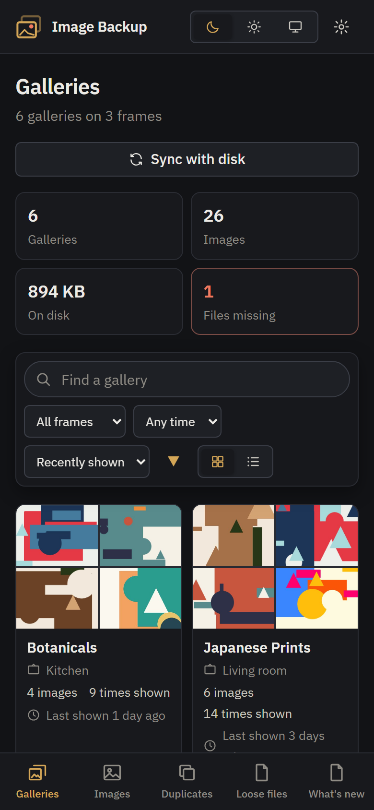
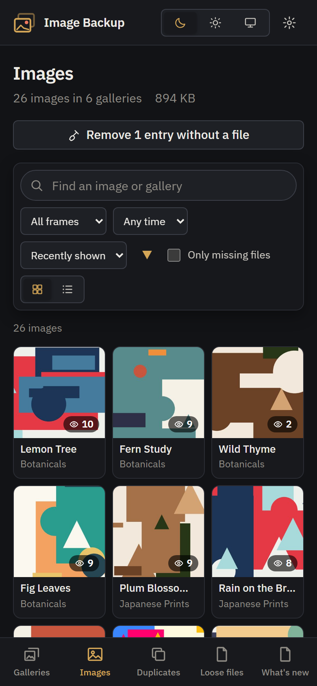

# MeuralImageBackup

[](https://github.com/geeForceOne/MeuralImageBackup/releases/latest)
[](https://github.com/geeForceOne/MeuralImageBackup/pkgs/container/meuralimagebackup)
[](LICENSE)

Keeps a local copy of every image shown on your Meural Canvas frames. Home Assistant tells the app which image a frame is showing; the app downloads it into a folder per frame and gallery and remembers how often and when each gallery and image was shown. The web interface lets you browse, filter and clean up the collection.

It's the successor of MeuralImageUploader 1.x and a drop-in replacement for it: same port, volumes, database, folders and API.



## What it does

- **Backs up what your frames show.** Every image a frame displays lands on your disk as `<frame>/<gallery>/<title>.jpeg`, downloaded once and never again.
- **Galleries.** A card per gallery with its images, the frame it played on, how often and when it was last shown. Each gallery has its own page.
- **Images.** All images as a grid or a table, with thumbnails, view counts and file sizes.
- **Viewer.** Open an image large, step through with the arrow keys, open or download the original, or delete it.
- **Find and filter.** Search by name, filter by frame and by "not shown for N days", and sort any way you like. Filters live in the URL, so Back brings them back.
- **Sync with disk.** One button adds what's in the uploads folder but missing from the database: folders become galleries, and an image shown from several galleries is listed in each.
- **Clean up.** Delete every gallery that hasn't been shown for a while in one go, and spot and remove entries whose file has gone missing.
- **Duplicates.** See which images are stored in several gallery folders and keep one copy, or store each image only once from the start (`SKIP_DUPLICATE_DOWNLOADS`).
- **A photo source for MeuralManager.** MeuralManager can browse the backup by date or gallery and put images into playlists, next to Immich, with a token from the Settings page.
- **Dark, light or system theme**, remembered per browser.
- **Works on phones and tablets**: sidebar on desktop, icon rail on tablets, tab bar on phones.
- **What's new.** After an update a banner links to the release notes.

| A gallery | The viewer |
| --- | --- |
|  |  |

| Images as a table | Light theme |
| --- | --- |
|  |  |

| On a phone | |
| --- | --- |
|  |  |

All names and pictures here are invented demo data.

## Run it

```yaml
services:
  meuralimagebackup:
    image: ghcr.io/geeforceone/meuralimagebackup:latest
    ports:
      - "8090:80"
    environment:
      USE_FRAME_NAME_IN_PATH: "true"
    volumes:
      - ./uploads:/app/uploads
      - ./database:/app/database
    restart: unless-stopped
```

Open http://localhost:8090. There's no login: put it on your home network, not on the internet.

| Path / variable | What it is |
| --- | --- |
| `/app/uploads` | The images, as `<frame>/<gallery>/<title>.jpeg` |
| `/app/database` | The SQLite database `meural.db` and the app's keys |
| `USE_FRAME_NAME_IN_PATH` | `false` leaves out the frame's folder: `<gallery>/<title>.jpeg`. Default `true` |
| `SKIP_DUPLICATE_DOWNLOADS` | `true` stores each image once: when a frame shows an image from another gallery and it's stored already, it isn't downloaded into that gallery's folder too. Default `false` |

### Coming from MeuralImageUploader 1.x?

Change the image to `ghcr.io/geeforceone/meuralimagebackup` and keep your volumes. The database is upgraded in place, existing files are found where they are, and your Home Assistant automations keep working unchanged.

## Connect Home Assistant

Add a `rest_command` that sends the frame's current image to the app:

```yaml
rest_command:
  meural_backup:
    url: http://<host>:8090/api/meural
    method: POST
    content_type: application/json
    payload: >
      {"frameName": "{{ frame }}", "gallery": "{{ gallery }}", "title": "{{ title }}",
       "url": "{{ url }}", "id": {{ id }}}
```

Then call it from an automation whenever a frame's image changes, with that frame's name and the image's gallery, title, URL and Meural id.

## API

### `POST /api/meural`

```json
{ "frameName": "Living room", "gallery": "Impressionists", "title": "Water Lilies", "url": "https://…/image.jpg", "id": 123456 }
```

Records the gallery and image and downloads `url`, unless the file is already there. All fields are optional. Always answers `200`.

### `GET /api/version`

The app's version as plain text, for example `2.0.0.0`.

### Photo source for MeuralManager

A read-only part of [Immich's API](https://immich.app/docs/api), for what MeuralManager uses, so it can browse this backup the way it browses Immich. Every request needs the token from **Settings → MeuralManager access** in an `X-API-Key` header; until a token is generated, every request gets `401`. Only a fingerprint of the token is stored; generating a new one stops the old one working.

| Call | What it answers |
| --- | --- |
| `GET /api/users/me` | A connection test |
| `GET /api/albums` | The galleries, with how many images each has and a cover image |
| `POST /api/search/metadata` | Images, newest first, in pages (`page`, `size`), by `takenAfter` / `takenBefore` and `albumIds`. The date is when the backup first saved the image |
| `POST /api/search/smart` | The same, with `query` as a text search on image and gallery names |
| `GET /api/assets/{id}/thumbnail?size=thumbnail\|preview\|fullsize` | The thumbnail (480 px), or the original for `preview` and `fullsize` |
| `GET /api/assets/{id}/original` | The image's file |

An image in several galleries is one asset. Immich's people, faces and AI search aren't available.

## Develop

```
dotnet build MeuralImageBackup.slnx
dotnet run --project src/MeuralImageBackup.Web     # http://localhost:5188, data in ./data
dotnet test tests/MeuralImageBackup.Tests
docker compose up --build
```

.NET 10, Blazor Server, SQLite. `src/MeuralImageBackup.Core` holds the logic (registration, downloads, file layout, cleanup) without any UI; `src/MeuralImageBackup.Web` is the web UI, the API and the host.

A `vX.Y.Z` tag publishes the image to `ghcr.io/geeforceone/meuralimagebackup` and creates the GitHub release from `CHANGELOG.md`.

## License

MIT
